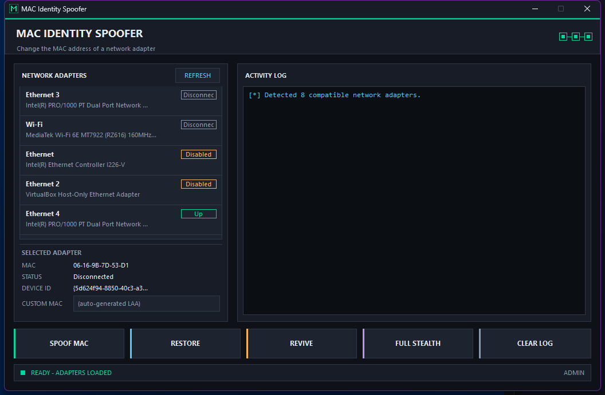

# MAC Identity Spoofer

Native Win32 GUI for changing the MAC address on a Windows network adapter.
The GUI is written in C++ with Win32/GDI and talks to `Spoof-Mac.ps1`, which
does the adapter work and streams its output back into the log panel.



## What it does

- Changes the MAC address of a selected Ethernet or Wi-Fi adapter, then
  restarts that adapter and renews the DHCP lease.
- Generates a random locally administered unicast address, or accepts a
  custom one typed into the GUI.
- Restores the factory MAC, revives an adapter stuck in a PnP disabled
  state, and optionally randomizes the computer name.
- Verifies the address Windows actually reports after the change and warns
  when a driver ignores the override.

## Usage

Run `MAC-Spoofer.exe` or `Spoof-Mac.bat` and approve the UAC prompt. Pick an
adapter from the list, then choose an action:

| Button | Action |
| --- | --- |
| SPOOF MAC | random LAA MAC, restart adapter, renew DHCP |
| RESTORE | remove the override and restore the factory MAC |
| REVIVE | re-enable an adapter stuck in a disabled state |
| FULL STEALTH | spoof the MAC and randomize the computer name |
| CLEAR LOG | clear the activity log |

The custom MAC field is optional. Leave it blank for a generated address.
Mouse wheel scrolls the adapter list and the log. Closing the window with
the X exits the app.

## Building

Needs `g++` and `windres` from MinGW-w64 or LLVM-MinGW on `PATH`.

```
build.bat
```

This generates `icon.ico`, compiles the resources, and produces
`MAC-Spoofer.exe`. The executable expects `Spoof-Mac.ps1` in the same folder.

## Files

| File | Purpose |
| --- | --- |
| `spoof.cpp` | Win32 GUI, custom-drawn with square corners |
| `Spoof-Mac.ps1` | engine; GUI drives it with `-Headless` |
| `Spoof-Mac.bat` | launcher with PowerShell fallback |
| `resource.rc` | icon, manifest, version resource |
| `app.manifest` | elevation and DPI settings |
| `make_icon.ps1` | generates `icon.ico` |
| `build.bat` | build script |

## Notes

Some wireless drivers ignore the `NetworkAddress` override. The tool checks
the result and tells you when that happens. A hostname change needs a reboot
before it applies fully.

## License

MIT. See [LICENSE](LICENSE).
